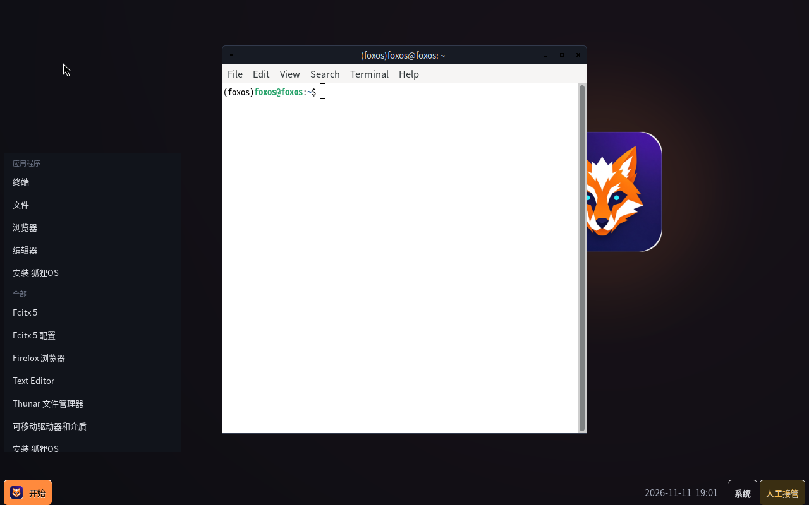
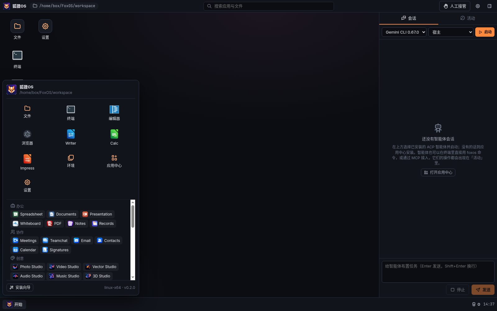
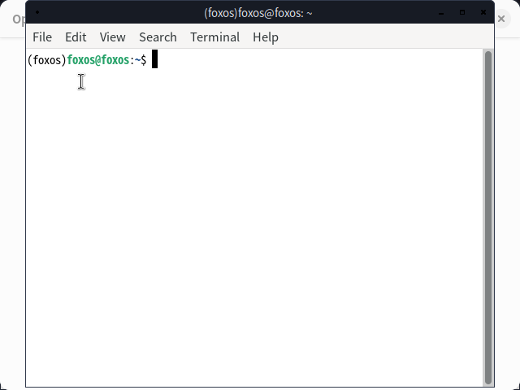
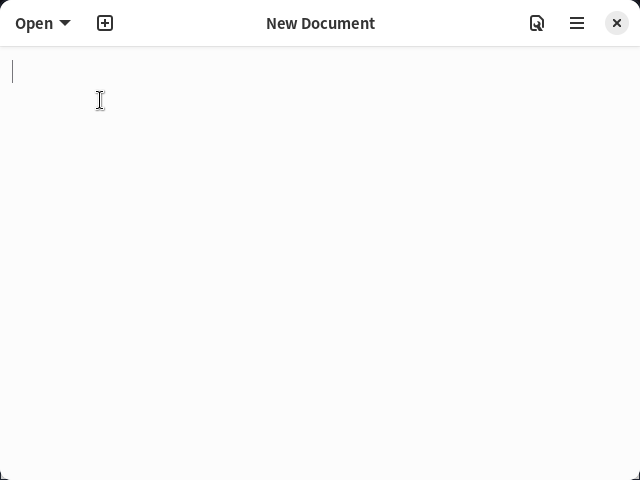

<p align="center"></p>

<h1 align="center">FoxOS (狐狸OS)</h1>

<p align="center">A desktop operating system for agents: real desktop apps, one <code>foxos</code> command line and MCP tool set for everything, audit log and human takeover, and a home-grown isolation layer.</p>

<p align="center"><a href="README.md">中文</a> · <a href="https://github.com/gatesenman/foxos/releases/tag/v0.3.0-os-preview">Bootable ISO</a> · <a href="https://github.com/gatesenman/foxos/releases/tag/v0.2.0-windows-preview">Windows companion preview</a> · <a href="docs/os-test-guide.md">ISO test guide</a> · <a href="AGENTS.md">AGENTS.md</a></p>



This screenshot is from a graphical session of the Live ISO (QEMU used for testing only). It shows real labwc windows: GNOME Terminal (`foxos@foxos`), the FoxOS bottom panel (Start, clock, System, Take over), and the start menu — not a painted Electron fake desktop.

## What it is

FoxOS is first a **bootable, installable Linux OS** (Ubuntu 24.04 base, Chinese default, labwc compositor + GTK panel). Agents (ACP/MCP clients such as Claude Code, Codex, Gemini CLI) and humans share a real desktop: every window is a real OS process.

The Windows `.exe` is a **companion** ([v0.2.0-windows-preview](https://github.com/gatesenman/foxos/releases/tag/v0.2.0-windows-preview)), not the ISO itself. We will not ship a macOS system image for non-Apple hardware.

Environments do not use Docker, Podman, or QEMU as the product runtime: full Linux guests use in-kernel KVM plus cloud-hypervisor (Apache-2.0); light sandboxes use namespaces; the Windows companion uses WSL2 / Hyper-V / Windows Sandbox. Docker Hub is only an optional distribution channel; see [docs/docker.md](docs/docker.md).

The workbench includes:

- **Real apps**: terminal (real PTY), file manager, Monaco editor, browser, native LibreOffice windows, and the 51 open-source Everything apps.
- **One operation, three entry points**: GUI, `foxos <app> <resource> <verb> --json`, and MCP tools (stdio and Streamable HTTP) all call the same kernel command.
- **Traceable and interruptible**: every call goes to a JSONL audit log; single-writer file locks; one-click human takeover pauses all agent writes.
- **Programs keep their own icons**: Everything apps show their upstream `icon-128.png` (MIT icons bundled, AGPL icons read from the installed upstream component), LibreOffice icons come from the local LibreOffice install, the terminal uses the system terminal icon, the editor VS Code / Code - OSS, the browser Electron, ACP agents the registry `icon`. FoxOS's own apps keep the FoxOS style; font icons are only for controls. See [NOTICE](apps/desktop/src/third-party-icons/NOTICE.md).
- **Chinese and English**: Simplified Chinese is the default; switch to English in the setup wizard or Settings (applies immediately, saved). The `foxos` CLI, MCP tool descriptions and kernel messages follow `--lang` / `FOXOS_LANG` (JSON field names and error codes never change); the Windows installer and `install.ps1` are bilingual; Everything apps receive the FoxOS language through the Chromium locale (Spreadsheet ships a Chinese UI and follows it; the others are English-only upstream and are marked so in the App Center).
- **Own scrollbars**: no default OS scrollbars anywhere. The shell, every window and every Everything app webview use a thin FoxOS overlay scrollbar (transparent track, hidden until hover or scroll, wider on hover, accent while dragging, dark/light aware); Monaco and the terminal use matching settings.
- **Own isolation layer**: no Docker or VM software. Linux namespaces on Linux; one-click WSL2 distros, Windows Sandbox and Hyper-V on Windows.

## Screenshots

Captured from the running desktop (xvfb, 1600×1000) with real files created in the workspace by `foxos` commands ([script](apps/desktop/scripts/screenshots.js)).

| | |
| --- | --- |
| <br>Start menu: built-ins and installed Everything apps in 9 groups, each with its project's own icon | <br>App center: 51 Everything apps with their upstream icons, plus built-ins, LibreOffice, tools, ACP agents |
| <br>First-run wizard with component picker | <br>Terminal running `foxos` commands |
| <br>File manager, live-synced workspace | <br>Monaco editor |
| <br>Browser | <br>Settings → Language: 简体中文 (default) / English, applies immediately |
| <br>App center in English: group names and app descriptions follow the language | <br>The same desktop in the default Chinese UI |
| <br>LibreOffice Writer with a generated .docx | <br>LibreOffice Calc: formulas and a native chart |
| <br>Everything Spreadsheet opening a workspace .xlsx (Chinese UI, shipped upstream, follows the FoxOS language) | <br>Everything Documents opening a workspace .docx |
| <br>Everything Whiteboard | <br>Everything CRM |
| <br>Everything Chess | <br>One-click ACP agent install from the official registry |
| <br>Environments → Install a system (WSL2 distros, rootfs, Windows Sandbox, Hyper-V) | <br>A running Alpine environment with live stats |
| <br>Activity log and human takeover (`PAUSED`) | |

## Download

**Bootable ISO (recommended):** [v0.3.0-os-preview](https://github.com/gatesenman/foxos/releases/tag/v0.3.0-os-preview) (pre-release). Write it to USB or boot it in Hyper-V; see the [ISO test guide](docs/os-test-guide.md).

| File | What it is |
| --- | --- |
| `FoxOS-0.3.0-amd64.iso` | Live + installer image (UEFI + BIOS), amd64, under 2 GB |
| `SHA256SUMS` | Checksums |

```bash
curl -L -O https://github.com/gatesenman/foxos/releases/download/v0.3.0-os-preview/FoxOS-0.3.0-amd64.iso
curl -L -O https://github.com/gatesenman/foxos/releases/download/v0.3.0-os-preview/SHA256SUMS
sha256sum -c SHA256SUMS
```

Real-desktop screenshots:

| | |
| --- | --- |
| <br>**Desktop**: labwc, bottom panel, start menu, GNOME Terminal | <br>**GNOME Terminal**: a real `foxos@foxos` session |
| <br>**Text editor**: a real GNOME Text Editor window | |

**Windows x64 companion preview:** [v0.2.0-windows-preview](https://github.com/gatesenman/foxos/releases/tag/v0.2.0-windows-preview) (pre-release, not yet verified on real Windows hardware — see the [test checklist](docs/windows-test-guide.md)).

```powershell
irm https://github.com/gatesenman/foxos/releases/download/v0.2.0-windows-preview/install.ps1 | iex      # anonymous download, verifies SHA256SUMS
$env:FOXOS_PORTABLE = '1'; irm https://github.com/gatesenman/foxos/releases/download/v0.2.0-windows-preview/install.ps1 | iex   # portable
$env:FOXOS_LANG = 'en-US'; irm https://github.com/gatesenman/foxos/releases/download/v0.2.0-windows-preview/install.ps1 | iex  # English messages (default: Chinese)
```

The setup program offers Simplified Chinese (default) and English and picks the one matching the Windows UI language.

`$env:GITHUB_TOKEN` is optional and only helps with GitHub's anonymous API rate limit. The installer is unsigned (SmartScreen warns on first run). Linux: boot the ISO above, or run the Windows/Linux companion from source. We do not ship a macOS OS image for non-Apple hardware.

## Quick start (from source)

```bash
git clone https://github.com/gatesenman/foxos.git && cd foxos
python3 -m venv .venv && .venv/bin/pip install -e 'packages/core[test]'
cd apps/desktop && npm ci && npm start
```

## For agents: CLI and MCP

See [AGENTS.md](AGENTS.md), `foxos agent-guide`, [agent guide](docs/agent-guide.md), [CLI reference](docs/cli-reference.md), [MCP reference](docs/mcp-reference.md).
Messages and command descriptions are Chinese by default; use `--lang en-US` or `FOXOS_LANG=en-US` for English (JSON field names, error codes and command names do not change).
Grammar `foxos <app> <resource> <verb> --json`; MCP tool names `<app>_<resource>_<verb>`; exit codes 0 OK, 1 ERROR, 2 USAGE, 3 NOT_FOUND, 4 PERMISSION_DENIED, 5 LOCKED, 6 DEPENDENCY_MISSING, 7 CONFLICT, 8 PAUSED.

## Everything apps (51)

From [HeyPuter/everything](https://github.com/HeyPuter/everything) at `0fbb88cd`. AGPL apps are built from upstream source at install time and are not modified or vendored.

<!-- apps:start -->
Runs locally: **50/51** · semantic CLI/MCP commands: **50/51** · boot e2e passed: **50/51** · GUI = CLI parity: **49/51** (details: [docs/everything-apps.md](docs/everything-apps.md))

| Group | Apps (ops = semantic commands) |
| --- | --- |
| Office | Spreadsheet `spreadsheet` (371 · AGPL)<br>Documents `documents` (311)<br>Presentation `presentation` (284 · AGPL)<br>Whiteboard `whiteboard` (26 · AGPL)<br>PDF `pdf` (85 · AGPL)<br>Notes `notes` (136 · AGPL)<br>Records `records` (16) |
| Collaboration | Meetings `meetings` (17)<br>Teamchat `teamchat` (6)<br>Email `email` (2 · AGPL)<br>Contacts `contacts` (28)<br>Calendar `calendar` (36)<br>Signatures `signatures` (29) |
| Creative Tools | Photo Studio `photo-studio` (104)<br>Video Studio `video-studio` (34 · AGPL)<br>Vector Studio `vector-studio` (90)<br>Audio Studio `audio-studio` (148)<br>Music Studio `music-studio` (266)<br>3D Studio `3d` (230 · AGPL) |
| Engineering | CAD `cad` (180 · AGPL)<br>Parametric `parametric` (33 · AGPL)<br>Circuits `circuits` (39 · AGPL)<br>Building Design `building-design` (1 · AGPL) |
| Productivity | Tasks `tasks` (58)<br>Projects `projects` (50)<br>Wiki `wiki` (60)<br>Time Tracking `time-tracking` (71)<br>Surveys `survey` (28) |
| Finance | Accounting `accounting` (45)<br>Invoicing `invoicing` (20)<br>Expenses `expense` (17)<br>Cap Table `cap-table` (27) |
| Business | CRM `crm` (16)<br>Help Desk `help-desk` (6)<br>Contracts `contracts` (14)<br>Point of Sale `pos` (17)<br>Inventory `inventory` (17)<br>Assets `assets` (0) — upstream source missing<br>Hiring `hiring` (22)<br>Shifts `shifts` (17)<br>Childcare `childcare` (39)<br>Field Service `field-service` (40)<br>Legal `legal` (43)<br>Fleet `fleet` (41)<br>Property Management `property-management` (45) |
| Developer Tools | API Client `api-client` (59) |
| Games | Chess `chess` (30)<br>Backgammon `backgammon` (27)<br>Checkers `checkers` (21)<br>Solitaire `solitaire` (9)<br>Sudoku `sudoku` (39) |
<!-- apps:end -->

## Environments

Linux: unprivileged user namespaces + overlayfs + pivot_root + seccomp, cgroup v2 when delegated (rlimit otherwise), snapshots, clones, `.foxenv` export, agents can run inside. Windows: WSL2 distro catalog with automatic WSL enablement, Windows Sandbox, Hyper-V. macOS: Virtualization.framework backend (untested on hardware). See [docs/environments.md](docs/environments.md) and the [provider protocol](docs/environment-provider-protocol.md).

Light isolation (`foxos sandbox`): run host tools directly, but only the workspace is readable/writable and network can be turned off (Linux Landlock + seccomp, macOS Seatbelt, Windows restricted token / AppContainer + job objects). Pick "轻量沙箱" as the run location in the session panel. See [docs/sandbox.md](docs/sandbox.md).

## Architecture

Desktop (Electron: window manager, built-in apps, Everything runtime, ACP client, app bridge) → kernel (Python `foxos`: command registry generating argparse / JSON Schema / MCP tools / docs; workspace confinement, locks, audit, takeover; apps; environment providers). See the diagram in [README.md](README.md#架构) and [docs/architecture.md](docs/architecture.md).

## Testing

`npm run test:all` at the repo root runs pytest, the Playwright + Electron end-to-end tests under xvfb and the official-MCP-SDK tests, and writes [docs/test-report.md](docs/test-report.md) (pass/fail/skip per user story, per-app coverage). No mocks.

Latest report (Linux): 140 cases — 134 passed, 1 failed, 4 skipped, 1 known upstream defect; 29/32 user stories passed; Everything apps 50/51 boot locally, 49/51 GUI/CLI parity, 51/51 MCP calls succeed; program icons: Everything 51/51, built-ins 6/6, ACP agents 45/45. See the [test report](docs/test-report.md).

## Roadmap

Done: kernel, audit, locks, takeover, MCP; desktop and real apps; 51 Everything apps (50 run); Linux environment runtime; Windows environment catalog; Windows x64 preview.
Light sandbox level: Linux Landlock + seccomp (tested); macOS Seatbelt and Windows restricted token / AppContainer + job objects (code and unit tests, not yet verified on hardware).
Chinese / English UI (Chinese default) and FoxOS scrollbars: done.
Next: Windows hardware verification; Linux packages; macOS build; code signing.

## License

No license has been chosen yet (no LICENSE file). AGPL Everything apps are not distributed with this repository.
