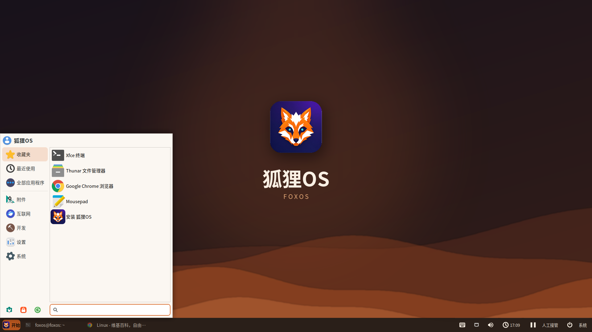
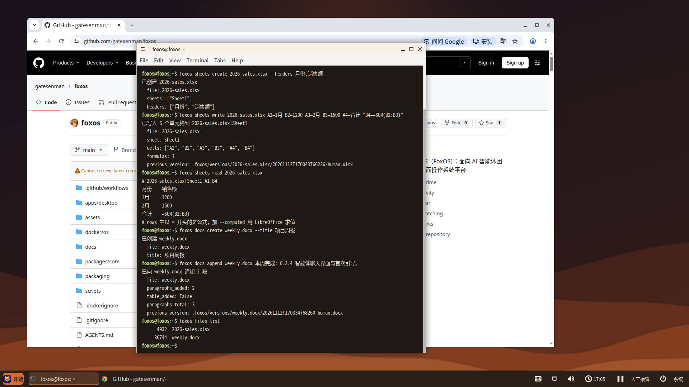
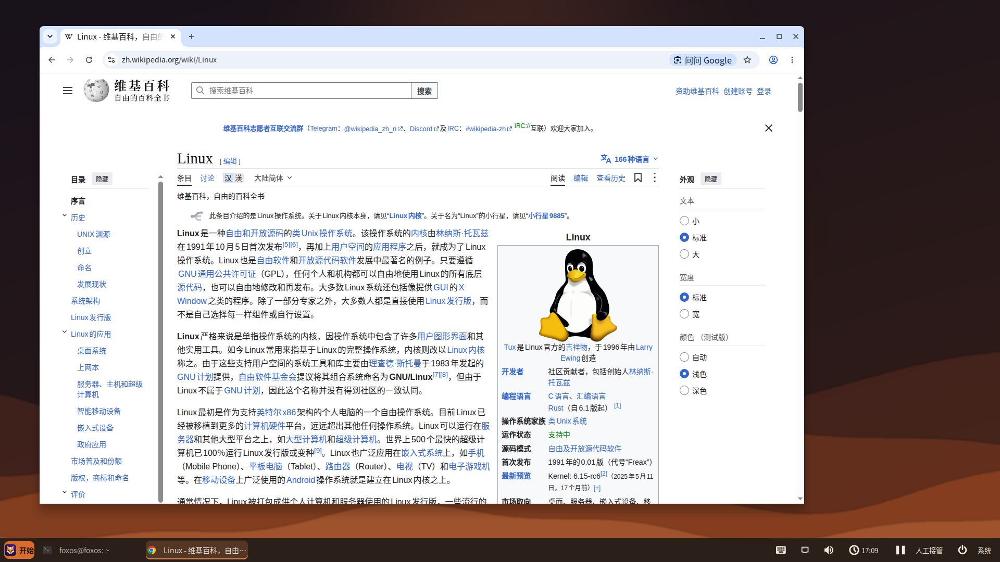
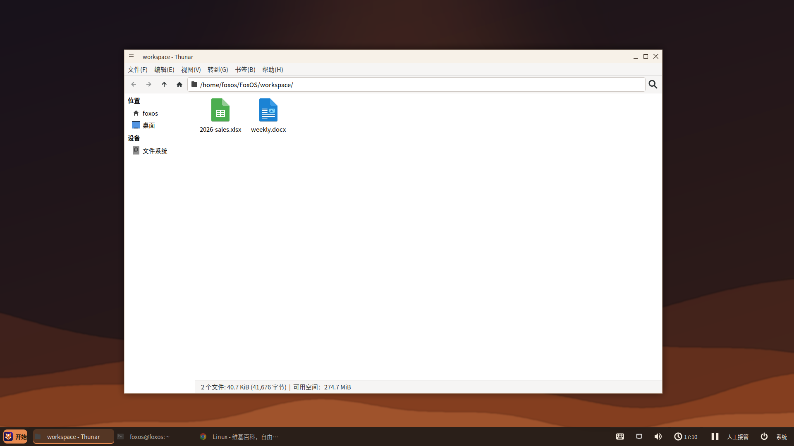
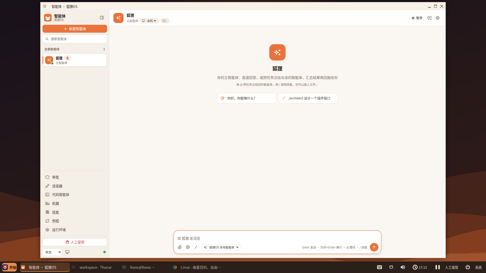
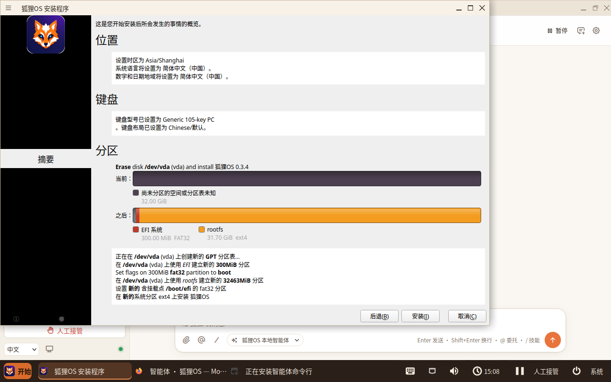
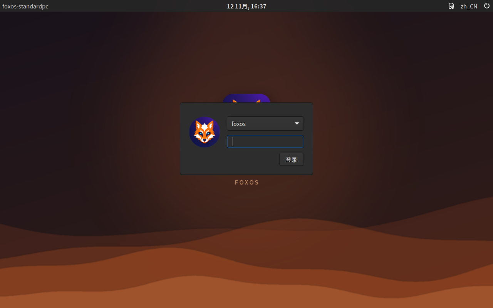
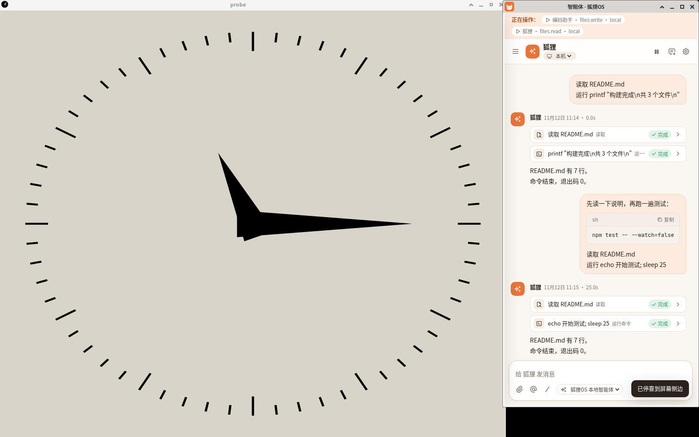
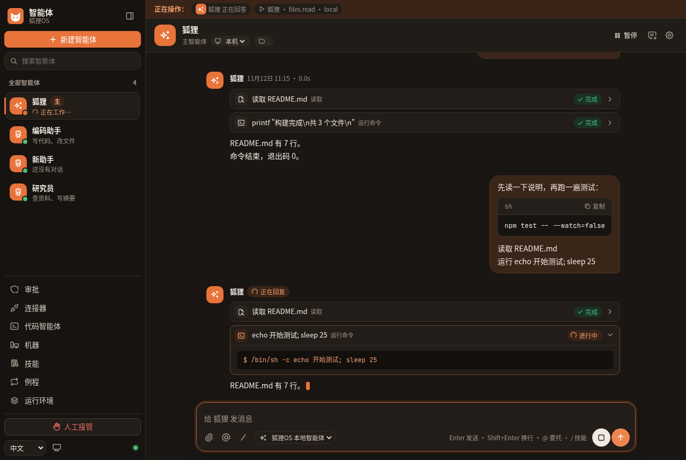
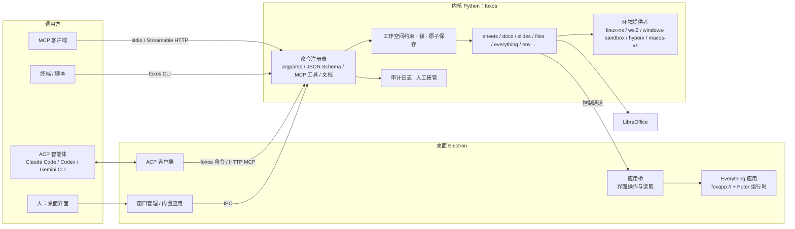

<p align="center"></p>

<h1 align="center">狐狸OS（FoxOS）</h1>

<p align="center">给智能体使用的桌面操作系统：真实的桌面与应用、统一的 <code>foxos</code> 命令与 MCP 工具、审计与人工接管、自研隔离环境。</p>

<p align="center">
  <a href="https://github.com/gatesenman/foxos/releases/tag/v0.3.4-os-preview">下载可引导 ISO</a> ·
  <a href="https://github.com/gatesenman/foxos/releases/tag/v0.3.4-windows-preview">Windows 伴侣预览</a> ·
  <a href="#快速开始">快速开始</a> ·
  <a href="AGENTS.md">智能体接入</a> ·
  <a href="docs/os-test-guide.md">ISO 测试指南</a> ·
  <a href="README.en.md">English</a>
</p>



这张截图来自在 QEMU 里引导的狐狸OS 0.3.4 ISO（Live 会话，`zh_CN`，1920×1080），首次登录弹出的对话框都已关掉。图里是真正的 xfwm4 桌面：Whisker「开始」菜单（收藏里有终端、Thunar、Google Chrome、Mousepad 和「安装 狐狸OS」）和底部面板（开始、时钟、人工接管、系统），不是 Electron 里画的假桌面。

## 狐狸OS 是什么

狐狸OS 首先是一个**可引导、可安装的 Linux 操作系统**（Ubuntu 24.04 基础，默认中文，XFCE 桌面）。它给智能体（Claude Code、Codex、Gemini CLI 等 ACP / MCP 客户端）和人一个共同的真实桌面：每个窗口都是真实的 OS 进程。

Windows 上的 `.exe` 是**伴侣程序**（预览版见 [v0.3.4-windows-preview](https://github.com/gatesenman/foxos/releases/tag/v0.3.4-windows-preview)），它是狐狸OS 虚拟电脑的客户端：显示来宾桌面和智能体聊天，所有动作都在狐狸OS 电脑里执行，本机执行默认关闭（见 [docs/windows-client.md](docs/windows-client.md)）；它不是这张 ISO 本身。我们不会在非 Apple 硬件上提供 macOS 系统镜像。

产品里的「环境」不依赖 Docker / Podman / QEMU 作为运行时：Linux 上来宾完整虚拟机走内核 KVM + cloud-hypervisor（Apache-2.0），轻量场景走命名空间。Docker Hub 只是可选的分发通道，见 [docs/docker.md](docs/docker.md)。

它给智能体和人的工作台包括：

- **真实的应用**：终端（真实 PTY）、文件管理器、Monaco 编辑器、浏览器、LibreOffice 原生窗口，以及 51 个 Everything 开源应用（表格、文档、白板、CRM、国际象棋……）。
- **同一套操作，三个入口**：图形界面、`foxos <应用> <资源> <动作> --json` 命令、MCP 工具（stdio 与 Streamable HTTP），调用的是同一个内核命令。
- **可追溯、可接管**：每次调用都写入审计日志；同一文件单写者锁；一键“人工接管”让所有智能体的写操作暂停。
- **自研隔离环境**：不依赖 Docker / 虚拟机软件；Linux 上用命名空间运行官方发行版根文件系统，Windows 上一键安装 WSL2 发行版、Windows Sandbox、Hyper-V 虚拟机。
- **内置智能体熟悉的东西**：标准 `.xlsx` / `.docx` / `.pptx`、Excel 公式、经典 CLI 约定（子命令、`--help`、`--json`、稳定退出码）、git、Python、Node。

## 截图（狐狸OS 0.3.4 真实系统）

下面每一张都来自狐狸OS 0.3.4 本身：Live 会话、安装程序和装好后的登录画面都是 0.3.4 ISO 在 QEMU 里引导后截的；首次登录的「安装 Google Chrome」「安装智能体命令行」「SSH 远程登录」对话框都已关掉，截图里没有一次性密码。没有任何拼接或模拟界面。

| | |
| --- | --- |
| <br>**桌面与开始菜单**：XFCE 桌面，Whisker「开始」菜单（中文、Papirus 图标），底栏是时钟 / 人工接管 / 系统 | <br>**终端里的 foxos 命令**：XFCE 终端里真实的 `foxos@foxos` 会话：`foxos sheets` 写入公式并读回、`foxos docs` 生成周报、`foxos files` 列出工作空间 |
| <br>**Google Chrome**：首次登录时从 Google 官方源装好的 Chrome 157（默认浏览器），中文界面 | <br>**Thunar 文件管理器**：工作空间里是终端里刚生成的 `.xlsx` / `.docx` |
| <br>**智能体窗口**：开始菜单「智能体」打开的主智能体「狐狸」，新的聊天界面，底部是审批、连接器、代码智能体、机器、技能、例程和运行环境 | <br>**安装 狐狸OS**：从 0.3.4 ISO 启动的 Calamares 安装程序，摘要页显示 EFI 分区和根分区 |
| <br>**装好后的系统**：0.3.4 装到虚拟磁盘后从磁盘启动的登录画面 | |

智能体聊天界面的更多截图在下方单独一节：[智能体聊天界面](#智能体聊天界面034--bot-chat-ui)。

## 功能

| 领域 | 内容 |
| --- | --- |
| 桌面 | 窗口管理（拖动、缩放、最大化、任务栏）、开始菜单、全局搜索（应用 + 工作空间文件）、会话恢复；无 emoji |
| 程序图标 | 每个程序显示它自己的开源项目自带的图标：Everything 应用用上游 `icon-128.png`（MIT 应用随附，AGPL 应用安装后从上游组件读取）、LibreOffice 用本机安装的图标、终端用系统终端图标、编辑器用 VS Code / Code - OSS 图标、浏览器用 Electron 图标、ACP 智能体用注册表 `icon` 字段；狐狸OS 自己的程序（文件、设置、环境、应用中心）保留狐狸OS 风格；线性字体图标只用于按钮等控件。来源与许可见 [third-party-icons/NOTICE.md](apps/desktop/src/third-party-icons/NOTICE.md) |
| 内置应用 | 终端（node-pty / ConPTY）、文件管理器、Monaco 编辑器、浏览器、应用中心、设置、安装向导、环境 |
| 办公 | `foxos sheets` / `docs` / `slides` 读写标准 .xlsx / .docx / .pptx（公式、原生图表、表格、备注），LibreOffice 原生窗口打开、求值与导出 |
| Everything 应用 | 51 个开源应用（9 个分组），本机构建运行；每个应用有从界面实际遍历出的语义命令（`foxos <应用> <资源> <动作>`），见 [docs/everything-apps.md](docs/everything-apps.md) 与 [docs/operations/](docs/operations/) |
| 智能体 | ACP 客户端（会话面板、运行位置：宿主或某个环境）、ACP 官方注册表一键安装、MCP 服务（stdio / Streamable HTTP、令牌、compact / full 工具集） |
| 安全与协作 | 工作空间约束（拒绝 `../`、符号链接逃逸、保留目录）、JSONL 审计日志、文件锁、原子保存与版本、人工接管（`PAUSED`，退出码 8） |
| 环境 | Linux 命名空间运行时（overlayfs、pivot_root、seccomp、cgroup v2 / rlimit）、`.foxenv` 镜像、快照、克隆、导出；Windows：WSL2、Windows Sandbox、Hyper-V；提供者协议；**在线安装预设系统**（已配好桌面、中文、Node / Bun / Python、ACP 智能体与 foxos 桥的 Debian 12 / Ubuntu 24.04 / 狐狸OS，以及按微软 / Apple 官方介质自动配置的 Windows 评估版与 macOS，分卷断点续传、sha256 校验），见 [docs/presets.md](docs/presets.md) |
| 多语言 | 简体中文（默认）与 English：安装向导第一步与设置里切换，立即生效并保存；`foxos` 命令行、MCP 工具说明与内核错误消息跟随 `--lang` / `FOXOS_LANG`（JSON 字段名与错误码不变）；Windows 安装程序与 `install.ps1` 中英双语；Everything 应用通过 Chromium 语言接收狐狸OS 语言，上游提供中文界面的（spreadsheet）随之切换，其余在应用中心标“英文界面”（逐个记录见 [docs/everything-apps.md](docs/everything-apps.md)）。词条在 `apps/desktop/src/locales/` 与 `packages/core/foxos/data/locales/` |
| 滚动条 | 不用系统默认滚动条：外壳、所有窗口与 Everything 应用（注入到每个 webview）统一用狐狸OS 细滚动条——轨道透明、平时隐藏、指向或滚动时出现、指向时加宽、拖动时为强调色，随深浅色主题变化；Monaco 与终端（xterm）使用相同尺寸与颜色 |
| 安装 | Windows / macOS / Linux 各 x64 与 arm64 的安装包（exe、msi、dmg、deb、rpm、AppImage、tar.gz）都自带 Python 3.12 与办公库，一行安装脚本校验 SHA-256（见 [docs/install.md](docs/install.md)）；首次运行向导按平台在线安装组件 |

## 下载

所有文件都在 [v0.3.2-os-preview](https://github.com/gatesenman/foxos/releases/tag/v0.3.2-os-preview)（预发布），每个文件的 SHA-256 在同一发布的 `SHA256SUMS` 里。两种东西不要混淆：

- **狐狸OS 操作系统**：可引导 ISO（Ubuntu 24.04 + XFCE），上面的截图就是它。0.3.2 起默认浏览器是 Google Chrome（首次登录时从 Google 官方源安装，见 [docs/os.md](docs/os.md#浏览器为什么-chrome-不在-iso-里怎么装)）。
- **桌面伴侣程序 + `foxos` 命令行**：装在现有 Windows / macOS / Linux 上的应用程序，自带 Python 3.12 与内核，装好就能在终端里用 `foxos`。

| 系统 | x64 | arm64 |
| --- | --- | --- |
| Windows 10 1809+ / 11 | `FoxOS-Setup-0.3.2-x64.exe`（安装程序）· `FoxOS-0.3.2-win-x64.zip`（便携版） | `FoxOS-Setup-0.3.2-arm64.exe` · `FoxOS-0.3.2-win-arm64.zip` |
| macOS 11+ | Intel：`FoxOS-0.3.2-mac-x64.zip` | Apple 芯片：`FoxOS-0.3.2-mac-arm64.zip` |
| Ubuntu / Debian / Mint / deepin / UOS | `FoxOS-0.3.2-linux-x64.deb` | `FoxOS-0.3.2-linux-arm64.deb` |
| Fedora / RHEL / Rocky / Alma / openEuler / openSUSE | `FoxOS-0.3.2-linux-x64.rpm` | `FoxOS-0.3.2-linux-arm64.rpm` |
| Arch / Manjaro / 其他发行版 | `FoxOS-0.3.2-linux-x64.tar.gz` · `.AppImage` | `FoxOS-0.3.2-linux-arm64.tar.gz` · `.AppImage` |
| **狐狸OS 系统 ISO** | `FoxOS-0.3.4-amd64.iso.part-00` + `.part-01` + `.part-02`（在 [v0.3.4-os-preview](https://github.com/gatesenman/foxos/releases/tag/v0.3.4-os-preview)，合并成 ISO，UEFI + BIOS） | 构建脚本已支持（`FOXOS_OS_ARCH=arm64`），等 GitHub Actions 恢复后在 arm64 机器上构建 |
| 包管理器（草稿，未提交） | winget `gatesenman.FoxOS` · Homebrew cask `foxos` · AUR `foxos-bin`，见 `FoxOS-0.3.2-package-manifests.zip` 与 [`packaging/`](packaging/) | 同左 |

端到端测试（安装 → 启动桌面 → `foxos --version` → `foxos sheets create` → 卸载）：Linux x64 的 deb / rpm / tar.gz / AppImage 已在 Ubuntu 24.04、Debian 12、Fedora 43、openSUSE Tumbleweed、Arch 上全部通过；Linux arm64 在 qemu 里验证了安装、命令行与卸载，桌面启动还要在真 arm64 机器上验证；**Windows 与 macOS 的安装包还没有在真机上测过，请当作预览**。MSI、dmg、arm64 ISO 和单文件 ISO 由 GitHub Actions（[`release.yml`](.github/workflows/release.yml)）构建并在各系统上跑端到端测试；仓库的 Actions 目前因 GitHub 账户账单问题无法启动，恢复后重新运行即可补上。详见 [docs/install.md](docs/install.md) 与[测试报告](docs/test-report.md)。

一行安装（自动识别系统与 CPU，下载、校验 SHA-256、安装，最后运行 `foxos --version`）：

```bash
# Linux / macOS：Ubuntu / Debian 用 deb，Fedora / RHEL / openSUSE 用 rpm，其他发行版或没有 sudo 时装到 ~/.local
curl -fsSL https://github.com/gatesenman/foxos/releases/download/v0.3.2-os-preview/install.sh | sh
```

```powershell
# Windows（x64 / arm64）；便携版先设 $env:FOXOS_PORTABLE = '1'，MSI 先设 $env:FOXOS_MSI = '1'
irm https://github.com/gatesenman/foxos/releases/download/v0.3.2-os-preview/install.ps1 | iex
```

安装包还没有代码签名：Windows 首次运行时 SmartScreen 选「更多信息 → 仍要运行」；macOS 首次打开时在「应用程序」里按住 Control 点按 FoxOS → 「打开」（macOS 15 起到「系统设置 → 隐私与安全性」点「仍要打开」）。每个系统的细节、AppImage 与 ISO 的用法见 **[docs/install.md](docs/install.md)**。

ISO（[v0.3.4-os-preview](https://github.com/gatesenman/foxos/releases/tag/v0.3.4-os-preview)）分三卷发布，每卷不到 1 GiB，下载后合并、校验（`SHA256SUMS` 在同一发布里）：

```bash
cat FoxOS-0.3.4-amd64.iso.part-00 FoxOS-0.3.4-amd64.iso.part-01 FoxOS-0.3.4-amd64.iso.part-02 > FoxOS-0.3.4-amd64.iso
sha256sum -c SHA256SUMS --ignore-missing
```

```powershell
cmd /c copy /b FoxOS-0.3.4-amd64.iso.part-00+FoxOS-0.3.4-amd64.iso.part-01+FoxOS-0.3.4-amd64.iso.part-02 FoxOS-0.3.4-amd64.iso
Get-FileHash -Algorithm SHA256 .\FoxOS-0.3.4-amd64.iso
```

写 U 盘或在 Hyper-V 里启动见 [ISO 测试指南](docs/os-test-guide.md)。旧版本（`v0.3.3-os-preview`、`v0.3.2-os-preview`、`v0.3.1-os-preview`、`v0.3.0-os-preview`、Windows 伴侣程序 `v0.2.0-windows-preview`）仍在 [Releases](https://github.com/gatesenman/foxos/releases) 页面。

## 智能体聊天界面（0.3.4） / Bot chat UI

狐狸OS 0.3.4 里的「智能体」窗口，Windows 伴侣程序 `v0.3.4-windows-preview` 里显示的也是同一个界面。截图里的智能体在本机的测试工作空间里干活。

| | |
| --- | --- |
| <br>**对话**：主智能体「狐狸」边回答边调用工具，每次读文件、运行命令都是一张能展开的卡片；顶部「正在操作」列出所有智能体当前在做的事 | <br>**审批**：「编码助手」要写文件时先给出差异，等你选「允许一次 / 总是允许 / 拒绝」 |
| <br>**停靠到屏幕边**：聊天窗停在桌面右侧，其他窗口照常使用 | <br>**智能体设置**：名字、头衔、指令、头像，以及技能与权限、记忆、审批规则、例程、委托、机器、电脑操控 |
| <br>**新对话**：主智能体的开场页和推荐问题 | <br>**深色模式**：同一段对话，跟随系统深色主题 |

## 快速开始

从源码运行（Linux，Windows 同理）：

```bash
git clone https://github.com/gatesenman/foxos.git && cd foxos
python3 -m venv .venv && .venv/bin/pip install -e 'packages/core[test]'
cd apps/desktop && npm ci && npm start          # 桌面；首次运行会打开安装向导
```

只用命令行：

```bash
export PYTHONPATH=$PWD/packages/core
python3 -m foxos --workspace ~/FoxOS/workspace sheets create 销售.xlsx
python3 -m foxos --workspace ~/FoxOS/workspace sheets write 销售.xlsx A1=月份 B1=金额 A2=1月 B2=120 'B3==SUM(B2:B2)'
python3 -m foxos --workspace ~/FoxOS/workspace env install alpine dev && python3 -m foxos env start dev
python3 -m foxos help --json      # 完整能力目录
```

## 给智能体：CLI 与 MCP

- 入门：[AGENTS.md](AGENTS.md)，或在终端运行 `foxos agent-guide`（含 Claude Code、Codex、Gemini CLI 的接入配置）
- 文档：[智能体指南](docs/agent-guide.md) · [命令参考](docs/cli-reference.md) · [MCP 工具参考](docs/mcp-reference.md)
- 语言：命令说明与消息默认中文，`--lang en-US` 或 `FOXOS_LANG=en-US` 切换为英文；JSON 字段名、错误码、命令名不随语言变化
- 约定：`foxos <应用> <资源> <动作> [--json]`；MCP 工具名 `<应用>_<资源>_<动作>`；退出码 0 成功、1 错误、2 用法、3 不存在、4 拒绝、5 被锁、6 缺依赖、7 冲突、8 已暂停

```bash
foxos --workspace ~/FoxOS/workspace mcp                                    # stdio
FOXOS_MCP_TOKEN=<令牌> foxos --workspace ~/FoxOS/workspace mcp --http 127.0.0.1:8765   # Streamable HTTP（POST /mcp）
foxos mcp --profile compact                                                # 精简工具集（通用 + everything_run）
```

- SSH：系统默认开 OpenSSH，只认密钥（密码登录默认关、root 禁止、防火墙放行 22）。智能体从别的电脑 `ssh foxos@<地址> foxos …`，或 MCP over SSH：`ssh -T foxos@<地址> foxos mcp`。现场会话会在桌面和控制台显示地址与一次性密码。详见 [docs/ssh.md](docs/ssh.md)

## Everything 应用（51 个）

来自 [HeyPuter/everything](https://github.com/HeyPuter/everything)（提交 `0fbb88cd`）。AGPL 应用在安装时从上游源码在本机构建，狐狸OS 不修改、不内置其源码。

<!-- apps:start -->
本机可运行 **50/51** · 有语义命令（CLI / MCP）**50/51** · 启动测试通过 **50/51** · 界面与命令等价 **49/51**（明细：[docs/everything-apps.md](docs/everything-apps.md)）

| 分组 | 应用（括号内为语义命令数） |
| --- | --- |
| 办公 Office | Spreadsheet `spreadsheet` (371 · AGPL)<br>Documents `documents` (311)<br>Presentation `presentation` (284 · AGPL)<br>Whiteboard `whiteboard` (26 · AGPL)<br>PDF `pdf` (85 · AGPL)<br>Notes `notes` (136 · AGPL)<br>Records `records` (16) |
| 协作 Collaboration | Meetings `meetings` (17)<br>Teamchat `teamchat` (6)<br>Email `email` (2 · AGPL)<br>Contacts `contacts` (28)<br>Calendar `calendar` (36)<br>Signatures `signatures` (29) |
| 创意 Creative Tools | Photo Studio `photo-studio` (104)<br>Video Studio `video-studio` (34 · AGPL)<br>Vector Studio `vector-studio` (90)<br>Audio Studio `audio-studio` (148)<br>Music Studio `music-studio` (266)<br>3D Studio `3d` (230 · AGPL) |
| 工程 Engineering | CAD `cad` (180 · AGPL)<br>Parametric `parametric` (33 · AGPL)<br>Circuits `circuits` (39 · AGPL)<br>Building Design `building-design` (1 · AGPL) |
| 效率 Productivity | Tasks `tasks` (58)<br>Projects `projects` (50)<br>Wiki `wiki` (60)<br>Time Tracking `time-tracking` (71)<br>Surveys `survey` (28) |
| 财务 Finance | Accounting `accounting` (45)<br>Invoicing `invoicing` (20)<br>Expenses `expense` (17)<br>Cap Table `cap-table` (27) |
| 业务 Business | CRM `crm` (16)<br>Help Desk `help-desk` (6)<br>Contracts `contracts` (14)<br>Point of Sale `pos` (17)<br>Inventory `inventory` (17)<br>Assets `assets` (0) — 上游缺源码<br>Hiring `hiring` (22)<br>Shifts `shifts` (17)<br>Childcare `childcare` (39)<br>Field Service `field-service` (40)<br>Legal `legal` (43)<br>Fleet `fleet` (41)<br>Property Management `property-management` (45) |
| 开发 Developer Tools | API Client `api-client` (59) |
| 游戏 Games | Chess `chess` (30)<br>Backgammon `backgammon` (27)<br>Checkers `checkers` (21)<br>Solitaire `solitaire` (9)<br>Sudoku `sudoku` (39) |
<!-- apps:end -->

## 环境

“环境”应用和 `foxos env` 命令管理隔离环境，详见 [docs/environments.md](docs/environments.md)：

- **Linux**：自研运行时，无特权用户命名空间 + overlayfs + pivot_root + seccomp，cgroup v2 可委派时限制资源，否则用 rlimit；工作空间挂载到 `/workspace`；快照、克隆、导出为 `.foxenv`；智能体可以在环境里运行
- **Windows**：一键安装 WSL2 发行版（Ubuntu、Debian、Kali、openSUSE、Fedora、AlmaLinux、Rocky、Oracle Linux、Arch、Alpine…），自动检测并启用 WSL；Windows Sandbox；Hyper-V 虚拟机
- **macOS**：Virtualization.framework 后端（代码与单元测试，未在硬件验证）；macOS 来宾按 Apple 许可禁用
- 提供者协议与系统目录：[docs/environment-provider-protocol.md](docs/environment-provider-protocol.md)；参考项目与许可证核对：[docs/virtualization-references.md](docs/virtualization-references.md)

轻量隔离（`foxos sandbox`）：不建独立系统，直接用宿主上的工具运行，但只能读写工作空间、可选不联网（Linux Landlock + seccomp，macOS Seatbelt，Windows 受限令牌 / AppContainer + 作业对象）。会话面板“运行位置”可选“轻量沙箱”。见 [docs/sandbox.md](docs/sandbox.md)。

## 架构



更多：[docs/architecture.md](docs/architecture.md)。

## 测试

```bash
npm run test:all      # 仓库根目录：pytest + 桌面端到端测试（Playwright + Electron，xvfb）+ MCP 官方 SDK 测试，生成 docs/test-report.md
```

- 测试不使用模拟：真实文件、真实 LibreOffice、真实 Electron、真实环境运行时、官方 MCP SDK 客户端
- 最近一次报告（Linux）：140 个用例 134 通过、1 失败、4 跳过、1 个已知上游缺陷；32 个用户故事 29 通过；Everything 应用 50/51 本地启动、49/51 界面与 CLI 等价、51/51 MCP 调用成功；程序图标 Everything 51/51、内置程序 6/6、ACP 智能体 45/45。详见 [测试报告](docs/test-report.md)
- 用户故事与测试一一对应（US-编号），报告列出每个故事的通过 / 失败 / 跳过、51 个应用的覆盖与每个应用的操作覆盖：[docs/test-report.md](docs/test-report.md)
- Windows 专用测试：命令行契约单元测试在 Linux 上运行；实机测试见 [docs/windows-test-guide.md](docs/windows-test-guide.md)

## 路线图

- [x] 命令内核、审计、锁、人工接管、MCP（stdio / HTTP）
- [x] 桌面、真实终端、文件、编辑器、浏览器、LibreOffice
- [x] 51 个 Everything 应用（50 个可运行）与语义命令
- [x] Linux 环境运行时；Windows 环境目录与提供者协议
- [x] Windows x64 预览版安装包
- [ ] Windows 实机验收（进行中）
- [x] 轻量沙箱档：Linux Landlock + seccomp（已测试）；macOS Seatbelt、Windows 受限令牌 / AppContainer + 作业对象（代码与单元测试，待实机验证）
- [ ] Linux 安装包与发布、macOS 构建
- [x] 中英文界面（默认中文）与狐狸OS 细滚动条
- [ ] 代码签名、自动更新

## 许可

仓库目前没有选定许可证（未包含 LICENSE 文件）。Everything 中的 AGPL 应用不随仓库分发，安装时从上游获取并保持原许可证；
WSL 发行版清单快照来自 microsoft/WSL（MIT，声明见 `packages/core/foxos/data/wsl/NOTICE.md`）。
