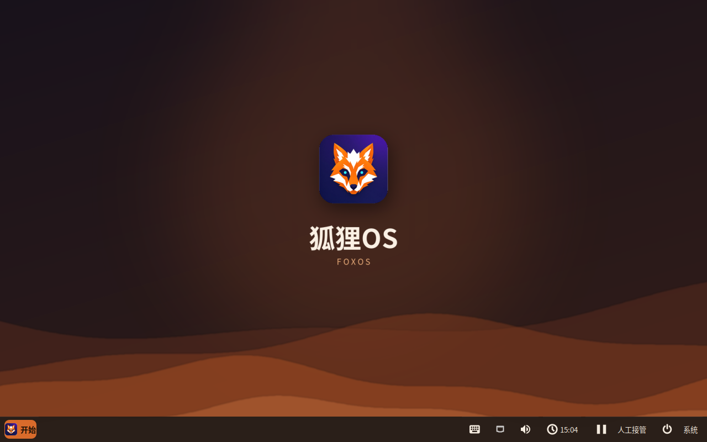
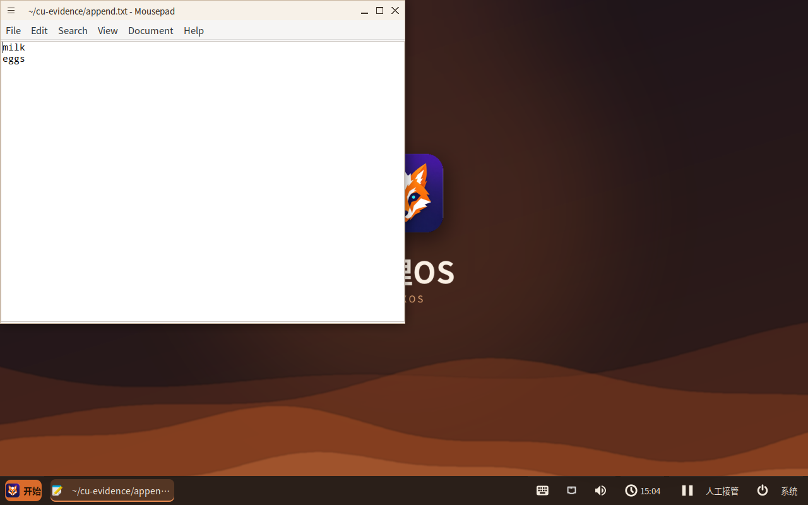
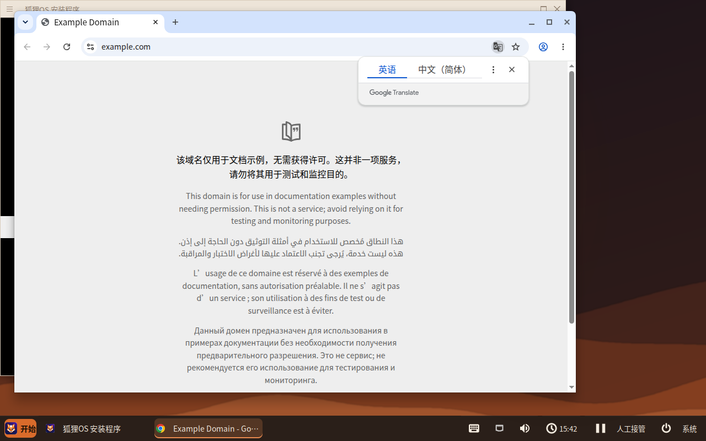
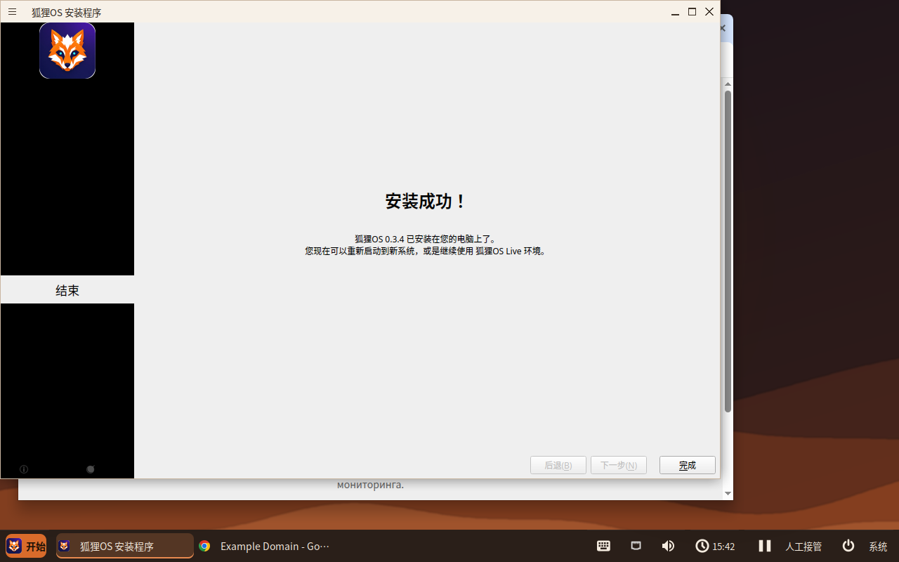
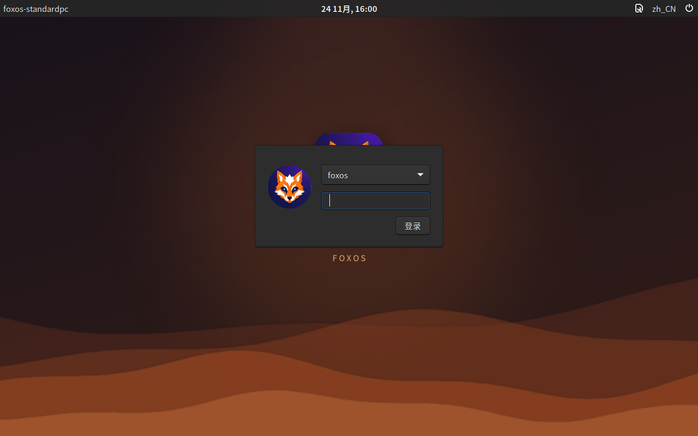

# 86c7c2e 候选镜像验证

本地候选，尚未发布。时间均为 Asia/Shanghai。内部版本仍为 0.3.4，但不是 GitHub 上已发布的 0.3.4 ISO。旧发布与旧验收记录未替换。

后续测试器修正与不改候选字节的复测见[控制器验证记录](controller-validation-2026-11-24.md)。下面保留该候选首次验收状态与全部失败。

## 实际测试的镜像

| 字段 | 值 |
|---|---|
| 干净源码提交 | `86c7c2e3977e11060ea7816cc5a59130acd0716e` |
| 文件 | `FoxOS-0.3.4-candidate-86c7c2e-amd64.iso` |
| 字节数 | `2250704896` |
| SHA-256 | `8f7658ba6019b40b2b39ecd9d2e096b323512abd491e92a18f3cce3724530bee` |
| 基础系统 | Ubuntu 24.04 noble，amd64，默认中文 XFCE |
| 虚拟机 | QEMU TCG，4 vCPU，4096 MiB，未使用 KVM |
| 构建来源 | `https://archive.ubuntu.com/ubuntu`，Ubuntu Release 签名校验通过 |

控制器在 Live 来宾可达时停止例程定时器并关闭 DPMS，减少 TCG 额外负载与黑屏。这不覆盖默认例程持续运行体验。

安装进 rootfs 的 78 个 Python 文件均与该提交一致。构建 rootfs 的凭证值扫描无命中。后续文档提交不属于该 ISO 的源码提交。本次记录的 24 项检查中，17 项 PASS、7 项 FAIL。FAIL 包含网络、存储与测试器断言问题，均保留，不能称为自动化整套零失败。

## 已完成的真实检查

| 检查 | 状态 | 实际证据与限制 |
|---|---|---|
| 构建机免凭证单元与集成回归 | PASS | 恢复 `python3-zstandard` 后，183 通过、27 跳过、零失败。官方 ACP 下载用例此前独立通过，不重复下载。跳过项不计为通过。 |
| Live SSH 安全 | PASS | 密钥登录成功，默认密码、错误密码与 root 被拒。Live 本次随机密码可登录，不记录密码。ufw active，放行 22。 |
| foxos 与 MCP over SSH | PASS | 256 个工具，真实 `tools/call ssh_status` 成功。 |
| 来宾运行时 | PASS | doctor 检查 32 项，agent-desktop 1.2.0 与 NOTICE 已预装。 |
| ACP | PASS | OpenCode 2.2.7 的 initialize 与 session/new 成功。不发送模型提示。 |
| 客户端所需的来宾通道 | PASS | ACP stdio 经 SSH 返回 initialize。SSH 转发读取 localhost x11vnc 的 RFB 握手。不代表真实 Windows 客户端已验收。 |
| 桌面控制 | PASS | 在该候选中实际启动、查找、聚焦、键入、回车、截图、关闭窗口。 |
| `cu_semantic` | PASS | 同一候选的实际 Mousepad 两项通过，73.70 秒。经无障碍语义动作编辑、菜单保存，再读取文件字节。不是规划器用例。 |
| Calamares 原始安装用例 | FAIL | 工作区 ENOSPC 使 QEMU io-error 暂停，原测试器超时。保留原始失败。 |
| 同一安装恢复后完成 | PASS | 释放本候选分卷占用后继续同一 QEMU、同一 Calamares 过程。15:36 完成 31/31 项，目标为 32 GiB 临时盘。 |
| Chrome 原始安装 | FAIL | Ubuntu HTTPS APT 经网络代理 TLS 中断，`fonts-liberation` 不可安装。 |
| 原始浏览器语义快照 | FAIL | Chrome 安装失败，CDP 不可用。 |
| Live 环境修复后的 Chrome | PASS | 仅把 Live Ubuntu archive 的 HTTPS 换成官方 HTTP。仍检查 APT 签名，Google 源保持 HTTPS 与固定公钥指纹。官方 Chrome 158.0.8127.88 安装、默认浏览器与 CDP 标签检查通过。不是原始配置全通过。 |
| 修复后快照的首个断言 | FAIL | 标题与后端正确，但外部网页正文不再包含标题字符串。过严断言失败，原始 JSON 保留。 |
| 对实际网页内容的新快照检查 | PASS | 再次真实调用 agent-browser@0.42.0。URL、标题、文档说明段落与 Learn more 链接均符合实际页面。未伪造或替换响应。 |
| Live 正常关机的首个观察器 | FAIL | Casper 等待介质移除确认，串口配置为只写文件。120 秒观察器超时，虚拟键盘回车无法送到串口。 |
| 串口确认后的正常关机 | PASS | 保持串口 PTY 连接输入回车后，内核输出 Power down，原 QEMU558846 正常退出。没有 kill 或 reset。立即观察器曾把串口 EOF 误判为未完成，之后按实际进程退出核对。 |
| 安装盘首次引导与 SSH 安全 | PASS | 只从本次安装的目标盘启动，无系统 ISO、无 SSH 种子光盘。Calamares 保存的公钥可登录，安装账户真实口令的 SSH 登录被拒，root 被拒，非 Live。 |
| 首个安装后重启观察器 | FAIL | 测试器错误假设安装后 sudo 免密，未观察到 boot ID 改变。只停止该观察器，没有停止 QEMU。未据此宣称操作系统重启失败。 |
| 安装后的真实重启 | PASS | 来宾 `systemctl reboot` 后 kernel boot ID 改变，密钥登录恢复。无系统 ISO 或 SSH 种子光盘。只作功能验收，不比较开机性能。 |
| 重启后的 MCP over SSH | PASS | 仍有 256 个工具，`tools/call ssh_status` 成功，密码登录关闭、root 登录关闭。 |
| 防火墙综合用例的硬件断言 | FAIL | ufw、sshd 与根分区输出正确，但测试器错误禁止任何 rom 设备。QEMU 默认空光驱不等于挂载了系统或种子介质。原失败保留。 |
| 实际防火墙与 sshd 输出核对 | PASS | 核对刚才实际命令的保存输出，未伪造或重跑。ufw active，22/tcp ALLOW，`passwordauthentication no`、`permitrootlogin no`，根为 `/dev/vda2`。 |
| 安装盘离线完整性 | PASS | 实际重启、正常关机之后，`qemu-img check` 零错误。 |
| US-121、US-122 完整规划器 | BLOCKED | 之前的 DeepSeek HTTP 401 未解决。本轮不重试无效凭证。 |
| 模型首轮对话与 358 秒问题 | NOT TESTED | 仅有一次 ACP 观察。来宾适配器的进程启动、初始化、建会话与停止累计 59675 ms，不含 SSH 与 CLI 前置开销。与 358 秒模型首轮不是同一测量，不能声称加速。 |
| 真实 Windows、Mac、WSL2 | NOT TESTED | 未操作任何用户电脑。 |
| GitHub 推送与发布 | BLOCKED | 原项目令牌无效。本轮未重试，没有新发布。Docker 发布仍暂停。 |

安装后的 sudo 需要口令。后续管理员操作只通过 SSH 标准输入传入现有临时安装账户的测试口令，没有修改 sudoers，也没有启用 SSH 密码登录。

实际保存的文件内容为 `Shopping list: apples, milk` 和 `milk\neggs`。`edited-files/manifest.json` 保存磁盘读回内容的哈希。编辑器进程使用测试的 C.UTF-8 菜单，不能把英文 Mousepad 菜单当作系统默认语言检查。

ACP 观察中 initialize 返回协议版本 1，session/new 的 `ok=true`。没有模型提示，也没有把错误响应当作快速完成。文件缓存已热，尚未测运行间波动或定位耗时上限。计时范围见 `packages/core/foxos/apps/acp.py` 的 `probe`。

## 存储事故与恢复

`/workspace` 和 `/home/box` 位于另一块 125 GiB 设备，不是仍有约 110 GB 空间的根分区。只检查 `/` 漏掉了该限制。安装写满工作区后，QEMU 因目标盘 `nospace` 暂停。

只迁移本候选的分卷，没有删除其他项目资料。第一次恢复时工具报告启动失败，但迁移已有部分副作用。后续误建的 part-00 自链接已用完整 ISO 的原始字节重建，哈希与原记录一致。三卷及拼接哈希均重新校验。`storage-recovery.json` 保留经过。

Chrome 环境修复在 Calamares 完成之后进行，没有复制进安装目标。安装后的 Chrome 仍未测试。Live 的介质弹出阶段出现 SQUASHFS 读错误，日志保留；不能把这些日志抹掉后声称原始用例全部通过。

ISO、安装目标盘和分卷已迁移到根设备的 `/opt/foxos-artifacts/candidate-86c7c2e/`。只在 QEMU 正常退出后复制目标盘与 ISO，比较复制前后的 SHA-256，再原子替换旧路径为链接。三卷位于该目录的 `parts/`，原证据路径仍可解析。最终 ISO 与全部分卷、拼接哈希再次通过校验。迁移后工作区约有 8.9 GiB 空间，根分区约有 101 GiB。

## 证据位置

精简的非敏感证据已保存在 [evidence/candidate-86c7c2e](evidence/candidate-86c7c2e)，包括源码身份、ISO 与分卷哈希，以及实际保存的两份文本。各批次回归有重叠，不能相加当作独立用例总数。

原始证据位于构建机 `/workspace/foxos-evidence/2026-11-24/candidate-86c7c2e/`。上层 `core-restored-full.log` 保存 183/27 的完整结果。安装后日志为 `e2e-post-install-resumed.log` 与 `e2e-installed-admin-corrected.log`。实际重启见 `installed-reboot-proof.json`，安全配置见 `installed-firewall-and-root.txt`。安装后控制器因空光驱断言返回 1，不能称为整套自动化零失败。原有失败见 `../core-all.log`、`../core-no-key.log`、`e2e-gui.log`、`e2e-install.log`。恢复安装见 `e2e-install-resumed.log` 和 `calamares-complete.log`。

`candidate.json`、`source-attestation.json`、`secret-scan.json`、`SHA256SUMS` 与 `parts-verification.json` 对应本候选。每个分卷小于 1 GiB。测试结束后，两处 Live 临时密码已从串口文件脱敏。测试私钥 `vm/id_ed25519` 不可公开分享。本轮 Live 与安装盘虚拟机会话均已正常停止，安装盘与证据保留。

## 剩余验证

- 原始 Chrome 安装仍受本网络的 Ubuntu HTTPS APT 失败影响。Live 修复不能替代下一候选原配置的连续复测。
- 正式测试器仍需吸收串口确认、安装后 sudo 口令输入、空光驱与空介质区分等改进。本次外部控制脚本与全部失败日志已保留。
- 完整模型规划器、真实模型首轮对话与真实 Windows、Mac、WSL2 仍未通过本候选验收。预设系统嵌套启动本轮未测试。
- 项目认证恢复前不推送、不发布。没有替换旧发布文件，也没有推送容器。
